# ETL Mercado Livre — Projeto UnderControll

Pipeline ETL em Python que coleta sinais de mercado do Mercado Livre (Trends, Highlights e
ofertas de catálogo), normaliza, filtra o domínio de pequenos eletrodomésticos, calcula um
score explicável e persiste o resultado em PostgreSQL para consumo pelo backend Java, que
agrupa, filtra e monta o payload de insights para uma AI.

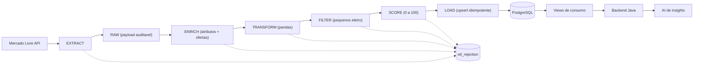

O backend Java nunca consulta o Mercado Livre: ele lê apenas a camada curada que este
pipeline persiste, preferencialmente pelas views descritas em
[Camada consumida pelo backend](#camada-consumida-pelo-backend).

O prompt e o dicionário de dados para a AI de insights estão em
[docs/ai-insights-prompt.md](docs/ai-insights-prompt.md).

## Endpoints do Mercado Livre

Todos os endpoints usam `site_id = MLB` e a base `https://api.mercadolibre.com`. O token é
obtido uma vez por execução via `client_credentials` e reaproveitado de memória enquanto
válido (margem de 60s antes da expiração de 6h).

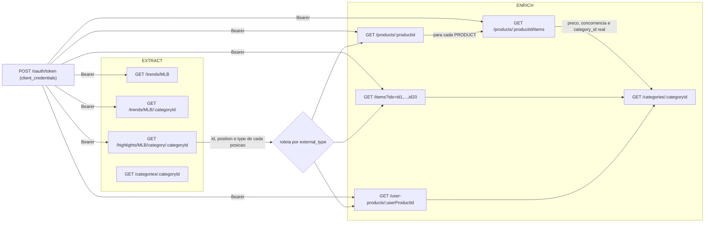

| Endpoint | Etapa | Token | Papel no pipeline |
|---|---|---|---|
| `POST /oauth/token` | Autenticação | — | Emite o access token da aplicação |
| `GET /trends/MLB[/:categoryId]` | EXTRACT | Bearer | Sinal de busca em alta, alimenta `source = TRENDS` |
| `GET /highlights/MLB/category/:categoryId` | EXTRACT | Bearer | Ranking top 20, alimenta `source = HIGHLIGHTS_CATEGORY` |
| `GET /categories/:categoryId` | EXTRACT e ENRICH | Público | Nome e `path_from_root` da categoria |
| `GET /items?ids=` | ENRICH | Bearer | Multiget de até 20 ITEMs por chamada |
| `GET /products/:productId` | ENRICH | Bearer | Ficha de catálogo: título, `domain_id` e atributos técnicos |
| `GET /products/:productId/items` | ENRICH | Bearer | **Única fonte de preço**: ofertas concorrentes com preço, vendedor e `category_id` real |
| `GET /user-products/:userProductId` | ENRICH | Bearer | Publicação de vendedor de um USER_PRODUCT |

### Por que o preço vem das ofertas de catálogo

A ficha de `GET /products/:productId` **não traz preço**: o campo `buy_box_winner` retorna
`null` para tokens de aplicação. E com credenciais `client_credentials` os endpoints
`GET /items/:itemId`, `GET /items/:itemId/prices` e `GET /sites/MLB/search` respondem
`403 access_denied`.

Isso deixa `GET /products/:productId/items` como o único caminho para preço no nível de
acesso do projeto. Ele compensa bem: uma chamada devolve a dispersão de preço completa
(mínimo, mediana, máximo), a profundidade da concorrência (`paging.total`), o desconto
vigente (comparando `price` com `original_price`) e o `category_id` real — que a ficha de
catálogo também não fornece.

A cobertura é total na prática, porque todas as posições do ranking de `MLB5726` retornam
com `type = PRODUCT`. Produtos sem ofertas utilizáveis geram um aviso em `etl_rejection` com
a regra `ofertas de catalogo indisponiveis para o produto` e seguem no pipeline sem preço.

Um método existe em [mercado_livre.py](ml_etl/api/mercado_livre.py) mas não está ligado ao
pipeline: `get_site_categories` (`GET /sites/MLB/categories`).

### Rate limit e falhas de rede

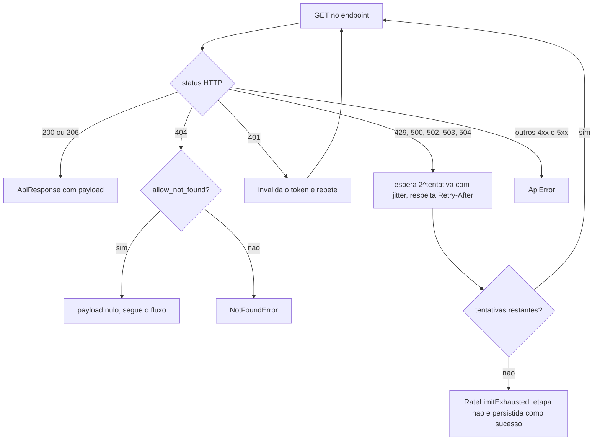

O teto de tentativas vem de `ETL_MAX_RETRIES`. O atraso base dobra a cada tentativa até 60s
e recebe um jitter aleatório de até 50% em cima, para evitar que execuções concorrentes
sincronizem os retries.

## Requisitos

- Python 3.11+
- PostgreSQL 14+ (opcional: SQLite para desenvolvimento)
- Aplicação registrada no [Mercado Livre Developers](https://developers.mercadolivre.com.br)

## Setup

```bash
python3 -m venv .venv
source .venv/bin/activate
pip install -r requirements.txt
cp .env.example .env
```

Preencha `ML_CLIENT_ID` e `ML_CLIENT_SECRET` no `.env` com as credenciais da sua aplicação.

## Uso

```bash
python main.py init-db
python main.py run
python main.py status
```

### Comandos

| Comando | Descrição |
|---|---|
| `init-db` | Cria o schema completo e as views de consumo |
| `create-views` | Recria apenas as views, sem tocar nas tabelas |
| `reset-db --yes` | Remove e recria o schema do zero, apagando todos os dados |
| `run` | Executa o pipeline ponta a ponta |
| `run --skip-api --run-id <uuid>` | Reprocessa a partir do RAW, sem chamar a API |
| `run --categories MLB5726,MLB432825` | Sobrescreve as categorias-alvo |
| `run --bucket day` | Sobrescreve a granularidade do snapshot |
| `status` | Mostra as últimas execuções e a contagem por tabela |

O `create-views` é útil depois de alterar [views.py](ml_etl/db/views.py): ele derruba e
recria as cinco views sem exigir recarga de dados.

### Alternando o banco

O backend é escolhido por `DB_BACKEND`:

- `postgres` — usa `DATABASE_URL`
- `sqlite` — usa `SQLITE_PATH` (arquivo local)
- `memory` — SQLite em memória, descartado ao fim do processo

```bash
DB_BACKEND=memory python main.py run
```

Em `memory` o `init-db` é implícito: o schema é criado junto com a engine.

## Processo ETL em detalhe

Cada etapa recebe e entrega um artefato explícito, e toda linha descartada vira registro em
`etl_rejection` com etapa, camada, regra e severidade.

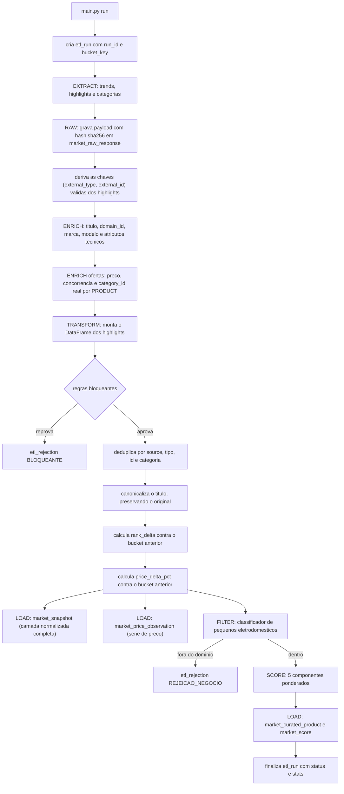

O `market_snapshot` guarda **todos** os registros estruturalmente válidos, mesmo os que o
FILTER descarta. Só o `market_curated_product` é restrito ao domínio de negócio. Isso
permite revisar a whitelist depois e reprocessar sem perder histórico.

### Reprocessamento a partir do RAW

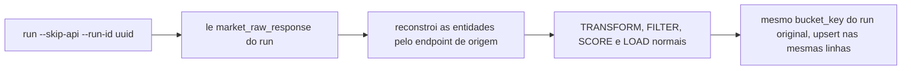

O endpoint gravado em cada payload é o que determina o `external_type` na reconstrução:
`/items` em lote, `/products/` e `/user-products/`. Os payloads de
`/products/:productId/items` são reconhecidos separadamente e reagregados, de modo que preço
e concorrência são reproduzidos no replay sem nova chamada à API.

## Classificação nas APIs

O `content[]` do Highlights mistura três tipos de identificador que **não** são
intercambiáveis, e cada um exige um endpoint diferente. O tipo é validado antes de qualquer
chamada de enriquecimento.

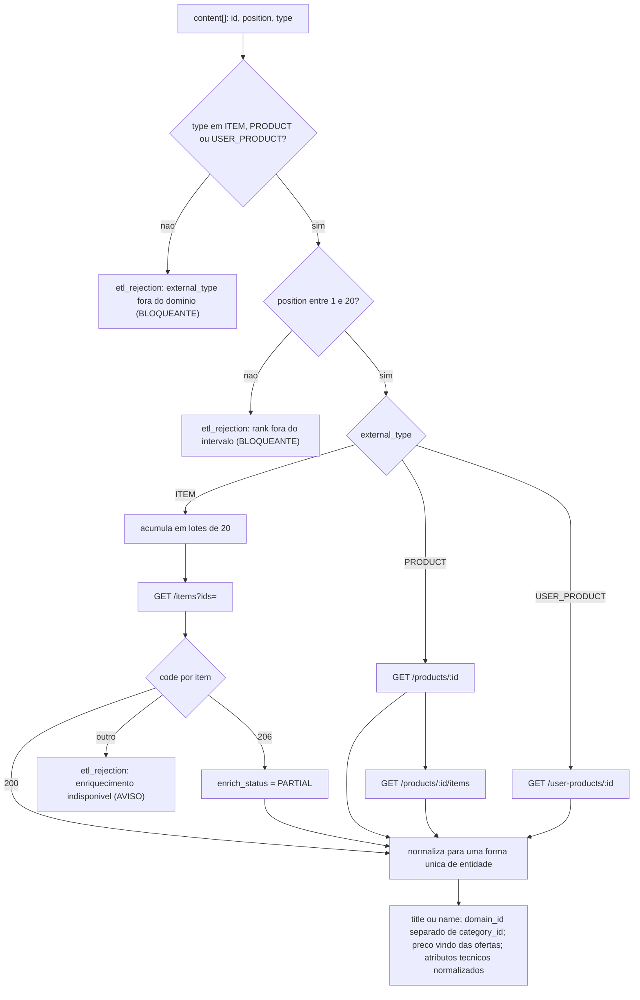

A normalização é o que permite tratar os três tipos como uma única entidade a partir do
TRANSFORM: `/products` devolve `name` em vez de `title` e não traz preço nem `category_id`,
enquanto `/items` traz `title` e `price` diretos.

Dois campos que antes se misturavam agora são distintos, e a diferença importa para quem
consome:

- `domain_id` (`MLB-MICROWAVES`) é o tipo de aparelho na taxonomia do Mercado Livre. É o
  grão correto para agrupar por tipo de produto.
- `category_id` (`MLB73057`) é a categoria real, resolvida a partir das ofertas de catálogo,
  e é a chave que faz join com `market_category` para obter o nome legível.

Os atributos técnicos saem do array `attributes` e viram colunas consultáveis:
`POWER` → `power_watts` (inteiro, entendendo `1.500 W` como 1500), `VOLUME_CAPACITY` →
`capacity_value` + `capacity_unit` (aceitando `12 Litros` e `4,5L`), `VOLTAGE` → `voltage`
(`110V`, `220V` ou `BIVOLT`), além de `MODEL`, `COLOR` e `ENERGY_EFFICIENCY`. A lógica está
em [attributes.py](ml_etl/domain/attributes.py).

A validação de tipo e de rank roda antes das chamadas de enriquecimento, para não gastar
requisição com linha inválida, mas as rejeições são gravadas com `stage = TRANSFORM` — é por
esse valor que você filtra em `etl_rejection`. As falhas de enriquecimento ficam com
`stage = ENRICH`.

### Classificador de domínio (FILTER)

Decide se o produto é um pequeno eletrodoméstico. As blacklists têm precedência sobre as
whitelists, para que acessórios e peças não entrem na camada curada mesmo quando o título
menciona o aparelho ou quando a categoria do Mercado Livre é de eletrodoméstico.

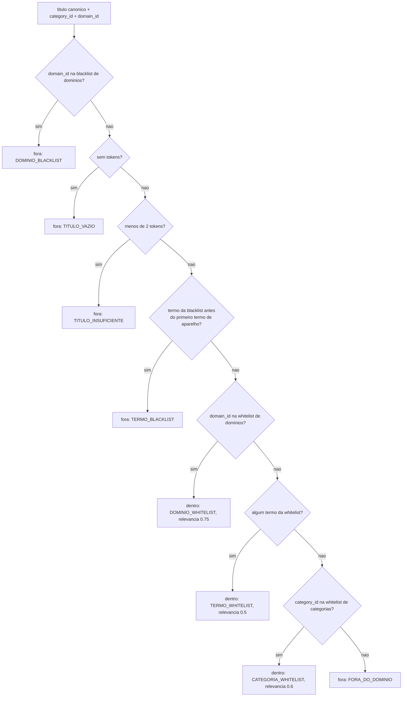

A `DOMAIN_WHITELIST` é a camada mais forte porque usa a própria taxonomia do Mercado Livre
em vez de heurística de texto, e a `DOMAIN_BLACKLIST` derruba classes inteiras que não são
aparelhos — refis de filtro, lâmpadas, baterias e peças de reposição — mesmo quando estão
bem ranqueadas em Eletrodomésticos.

A ordem importa: a blacklist de termos roda **antes** da whitelist de domínios, para que uma
"Capa Protetora Para Air Fryer" publicada em `MLB-AIR_FRYERS` continue sendo rejeitada.

A blacklist de termos usa a **posição** no título, não a simples presença. Anúncio de
acessório abre o título com o acessório ("Capa Protetora Para Air Fryer", "Refil Filtro
Acqua Pure"), enquanto aparelho que só menciona um acessório abre com o aparelho ("Aspirador
Pó e Água 1400w Filtro Lavável", "Balança Digital Cozinha 10kg ... Pilha"). Um termo
bloqueado só rejeita quando aparece antes do primeiro termo de aparelho reconhecido. Sem essa
regra, o aspirador e a balança acima — dois eletrodomésticos legítimos e bem ranqueados —
eram descartados por causa do filtro lavável e da pilha inclusa.

Cada whitelist tem uma relevância base, somada a 0,1 por termo de aparelho reconhecido no
título (limitado a +0,25). O total é limitado a 1.0 e entra no score como o componente
`relevance`. O motivo da decisão é persistido em `market_curated_product.domain_reason`, de
modo que a AI e o backend vejam por que cada produto foi aceito. As listas ficam em
[whitelist.py](ml_etl/domain/whitelist.py) e a especificação prevê revisão mensal delas.

### Canonicalização do título

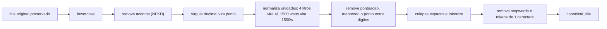

Se o resultado ficar vazio, a linha é rejeitada com severidade de aviso e o payload
original permanece no RAW.

## Idempotência

Toda carga usa `INSERT ... ON CONFLICT DO UPDATE`, com a chave lógica ancorada em
`bucket_key` — derivado de `collected_at` conforme `ETL_SNAPSHOT_BUCKET`:

- `month` (default) → `2026-08`
- `day` → `2026-08-29`

Rodar o pipeline várias vezes dentro do mesmo bucket atualiza as mesmas linhas em vez de
duplicá-las. As chaves únicas são:

- `market_entity` → `(external_type, external_id)`
- `market_snapshot` → `(source, external_type, external_id, category_id, bucket_key)`
- `market_trend` → `(category_id, keyword, bucket_key)`
- `market_score` → `(external_type, external_id, bucket_key)`
- `market_curated_product` → `(source, external_type, external_id, bucket_key)`
- `market_raw_response` → `(run_id, payload_hash)`

## Agendamento mensal

```bash
python scheduler.py
```

Lê `ETL_SCHEDULE_CRON` (default `0 3 1 * *`: 03:00 do dia 1 de cada mês). Alternativa via
crontab do sistema:

```cron
0 3 1 * * cd /caminho/do/etl && .venv/bin/python main.py run >> logs/etl.log 2>&1
```

## Score explicável

O score de 0 a 100 é a soma ponderada de cinco componentes, cada um também normalizado de 0
a 100. Os pesos vêm de `SCORE_WEIGHTS` e são renormalizados para somar 1, então mudar um
peso não desloca a escala.

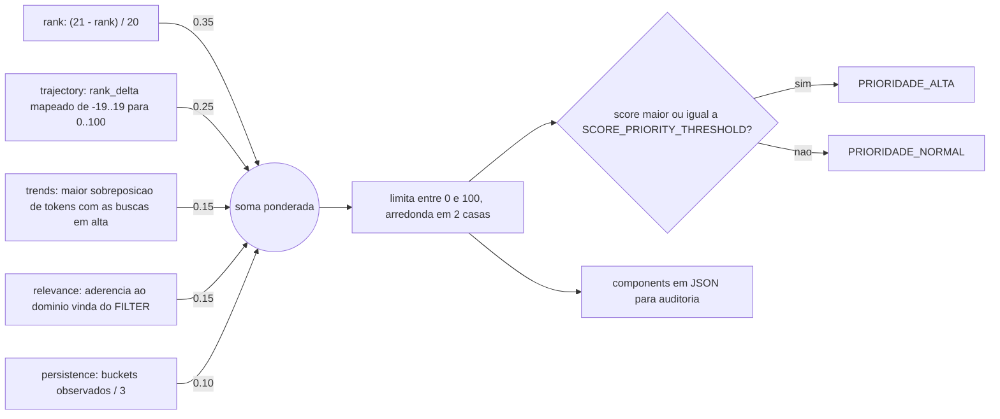

Detalhes que valem atenção em cada componente:

- `rank` — rank 1 vale 100, rank 20 vale 5. É o sinal mais pesado.
- `trajectory` — sem bucket anterior o valor é neutro (50), não zero, para não punir um
  produto só por ser novo na base.
- `trends` — só pontua a partir de 34% de sobreposição de tokens, evitando casamento por
  palavra genérica solta.
- `relevance` — base de 0.75 quando a decisão veio do `domain_id`, 0.6 quando veio da
  categoria e 0.5 quando veio de termo do título, mais 0.1 por termo reconhecido (até +0.25).
- `persistence` — satura em 3 buckets observados.

### Por que preço não entra no score

O score mede **popularidade**, e preço e concorrência ficam deliberadamente fora da fórmula.
Se movimento de preço somasse pontos, "produto em alta" ficaria ambíguo: não daria para saber
se subiu a demanda ou o preço. Mantendo os sinais separados, o consumidor pode cruzá-los e
distinguir situações que exigem decisões opostas — score alto com preço em queda indica
concorrência aquecida e oportunidade de estoque, enquanto score alto com preço em alta indica
demanda aquecida e espaço para reajuste.

### Confiança e determinismo

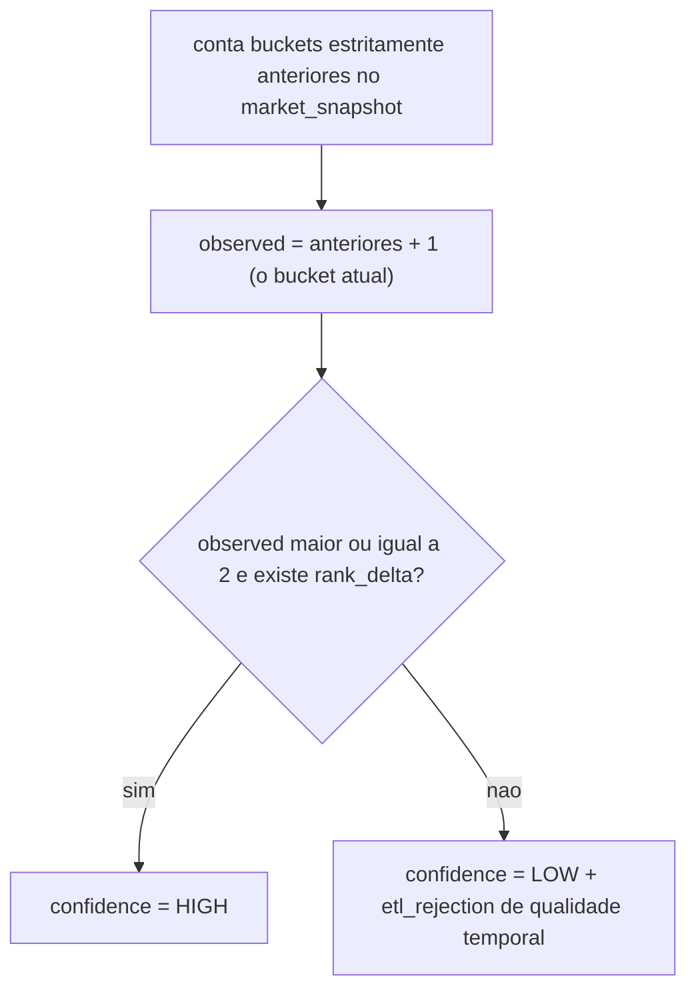

Contar apenas buckets **estritamente anteriores** é o que garante o determinismo: se o
bucket corrente entrasse na contagem, a primeira execução do mês veria zero snapshots e a
segunda veria um, produzindo scores diferentes para o mesmo período. Com o corte estrito,
reexecutar o mesmo bucket sempre produz o mesmo score, e a suíte de testes verifica isso.

O `confidence = LOW` inicial atende o risco de "poucos snapshots no início" previsto na
especificação: o score existe, mas sinalizado como pouco confiável até haver histórico.

## Testes

```bash
.venv/bin/python -m unittest discover -s tests -t .
```

Cobertura (mínimo de 80% em `ml_etl`, configurado em `.coveragerc`):

```bash
.venv/bin/pip install -r requirements-dev.txt
.venv/bin/coverage run -m unittest discover -s tests -t .
.venv/bin/coverage report
```

A suíte usa SQLite em memória e uma API simulada (`tests/fake_api.py`), sem chamadas de
rede. Cobre a execução ponta a ponta, a idempotência de reexecuções (incluindo
`market_price_observation`), o reprocessamento a partir do RAW com replay das ofertas, a
agregação de preço e concorrência, a normalização de atributos em formato pt-BR, as regras de
rejeição por domínio, a variação de preço entre buckets, as cinco views de consumo e a
canonicalização.

Há uma regressão específica para o bug que motivou esta versão: `category_id` precisa conter
o ID real (`MLB73057`) e não o `domain_id`, com `domain_id` guardado em coluna própria.

O `setUp` isola o ambiente por completo: limpa `os.environ`, injeta apenas as variáveis do
teste e carrega as settings com `use_dotenv=False`. Isso impede que o seu `.env` local
vaze para a suíte e, principalmente, que os testes escrevam no banco de desenvolvimento.
Há uma asserção explícita de que o backend em uso é o de memória.

## Estrutura

```
ml_etl/
├── config.py            Settings carregadas do .env
├── logging_config.py
├── auth/                token client_credentials com cache
├── api/                 cliente HTTP (backoff + jitter) e endpoints do Mercado Livre
├── db/                  engine, models, views de consumo e upsert dialect-aware
├── domain/              buckets, canonicalização, atributos, whitelist e rejeições
└── pipeline/            extract, raw, enrich, offers, transform, filters, score, load, orchestrator

docs/
└── ai-insights-prompt.md   prompt, dicionário de dados e guardrails para a AI
```

## Modelo de dados

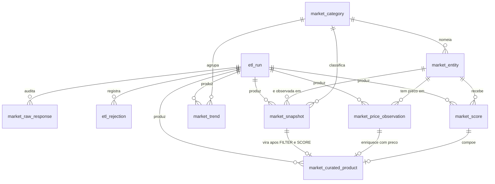

As camadas se dividem assim:

- **Auditoria** — `etl_run`, `market_raw_response`, `etl_rejection`
- **Referência** — `market_category`, `market_entity`
- **Série temporal** — `market_snapshot`, `market_trend`, `market_price_observation`
- **Analítica** — `market_score`, `market_curated_product`

### `market_price_observation`

Uma linha por produto por bucket, única em `(external_type, external_id, bucket_key)`. Guarda
a distribuição de preço (`price_min`, `price_p25`, `price_median`, `price_p75`, `price_max`),
a concorrência (`offer_count`, `seller_count`, `official_store_count`), o desconto
(`original_price_median`, `discount_pct_median`) e quem lidera o card (`winner_item_id`,
`winner_price`).

É a tabela que constrói a série histórica de preço. Como a granularidade padrão é mensal,
uma comparação mês contra mês exige dois ciclos de coleta: no primeiro mês `price_delta_pct`
sai nulo por definição.

## Camada consumida pelo backend

O contrato principal é a tabela `market_curated_product`, agora desnormalizada para que o
backend responda a perguntas de agrupamento sem join. Além dos campos de ranking e score, ela
carrega taxonomia (`domain_id`, `category_id`, `category_name`), identidade
(`brand`, `brand_slug`, `model`, `product_key`), atributos técnicos (`voltage`,
`power_watts`, `capacity_value`, `capacity_unit`, `energy_efficiency`), preço e concorrência
(`price_min`, `price_median`, `price_max`, `price_delta_pct`, `discount_pct`, `offer_count`,
`seller_count`) e a rastreabilidade da classificação (`relevance`, `domain_reason`).

Sobre ela existem cinco views, criadas pelo `init-db` e recriáveis com `create-views`:

| View | Grão | Para que serve |
|---|---|---|
| `vw_market_product_current` | um produto | foto achatada do bucket mais recente |
| `vw_market_rising_products` | um produto | a tabela de produtos em alta, já filtrada |
| `vw_market_category_summary` | `domain_id` + bucket | agrupamento por tipo de aparelho |
| `vw_market_brand_summary` | `brand_slug` + bucket | agrupamento por marca |
| `vw_market_price_movement` | `domain_id` + bucket | variação de preço mês a mês |

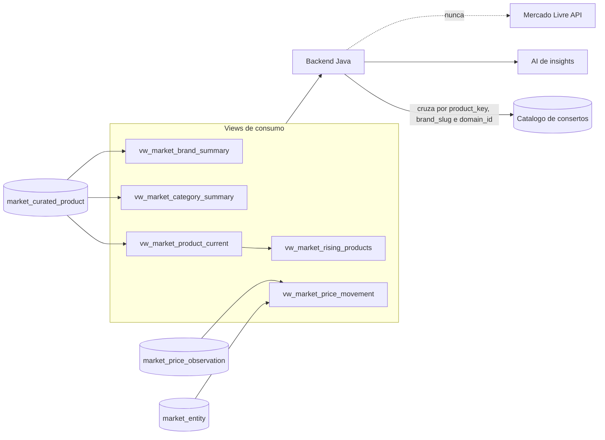

### Chaves para cruzar com os consertos do cliente

O ETL não conhece os consertos: ele expõe chaves normalizadas e o backend faz o match em três
níveis, do mais preciso ao mais abrangente.

| Nível | Chave | Significado |
|---|---|---|
| exato | `product_key` (`electrolux:me23s`) | o mesmo modelo que o cliente conserta |
| bom | `brand_slug` + `domain_id` | mesma marca e mesmo tipo de aparelho |
| cobertura | `domain_id` | mesmo tipo de aparelho, marca diferente |

A ausência de match também é informação: um `domain_id` em alta que não aparece no catálogo
do cliente é candidato a expansão de serviço. A estratégia completa, com as consultas SQL
prontas, está em [docs/ai-insights-prompt.md](docs/ai-insights-prompt.md).

Registros descartados por qualquer regra ficam em `etl_rejection`, com etapa, camada,
regra e severidade.
