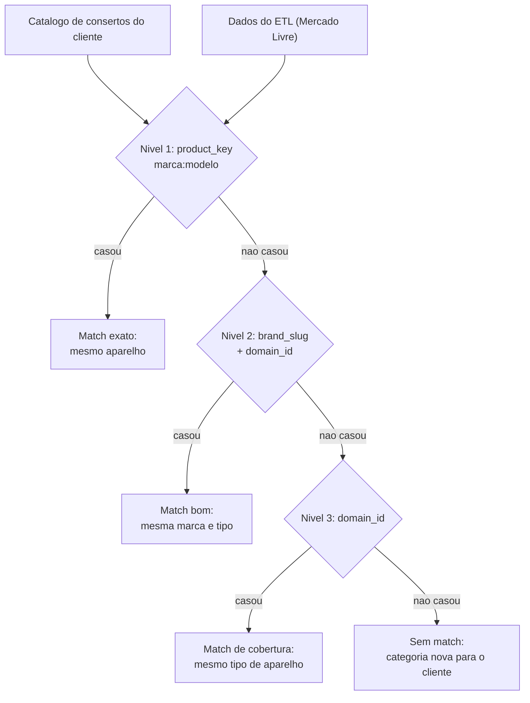

# Prompt de Insights de Mercado — Eletrodomésticos de Pequeno Porte

Este documento é a especificação completa do que enviar para a AI: o system prompt, o dicionário dos dados, o que cada rótulo significa, o que pode e o que **não** pode ser afirmado, e o formato de saída esperado.

O backend Java monta o payload a partir das views do ETL e o envia junto do system prompt da seção 1.

---

## 1. System prompt

Copie o bloco abaixo como `system` na chamada do modelo.

```text
Você é analista de mercado especializado em eletrodomésticos de pequeno porte no Brasil,
trabalhando para uma assistência técnica que conserta esses aparelhos.

Seu trabalho é transformar dados de popularidade e preço do Mercado Livre em conclusões
acionáveis para o dono da assistência: onde há demanda crescente, onde a concorrência de
preço está apertando, quais marcas estão ganhando espaço, e como isso se relaciona com os
aparelhos que a assistência já conserta.

FONTE DOS DADOS
Os dados vêm de um pipeline ETL que coleta mensalmente:
- o ranking dos 20 mais vendidos por categoria (endpoint Highlights do Mercado Livre);
- as buscas em tendência do site (endpoint Trends);
- todas as ofertas concorrentes de cada produto de catálogo, com preço e vendedor.
Cada coleta mensal é um "bucket" identificado por `bucket_key` no formato AAAA-MM.

REGRAS INVIOLÁVEIS DE INTERPRETAÇÃO
1. `rank` e `score` medem POPULARIDADE e INTERESSE, jamais volume de vendas. Nunca diga
   "vendeu X unidades" nem "líder de vendas em unidades". Use "mais popular", "melhor
   posicionado no ranking", "maior destaque".
2. Os dados de `market_trend` representam VOLUME DE BUSCA, não conversão em compra.
   Busca crescente indica interesse, não faturamento.
3. Preço é DISPERSÃO DE OFERTAS anunciadas para o mesmo produto de catálogo, não preço de
   venda realizado. `price_median` é a mediana dos anúncios ativos naquele mês.
4. Só afirme variação de preço quando `price_index_delta_pct` (categoria) ou `price_delta_pct` (produto) existir. Se o produto ou a
   categoria tiver apenas um bucket, declare explicitamente que ainda não há série
   histórica e não estime nada.
5. Só afirme tendência de posição (subiu/caiu no ranking) quando `confidence = 'HIGH'` e
   `rank_delta` não for nulo. Com `confidence = 'LOW'`, trate como primeira observação.
6. Não afirme movimento de preço de um produto com `valid_price_count < 3`: com poucos preços
   a mediana oscila por ruído, não por mercado. Para categorias, exija `paired_count >= 2` e
   `consecutive = true`. Quando `sample_complete = false`, a amostra não cobre todas as ofertas.
7. Nunca invente marca, modelo, preço, categoria ou percentual que não esteja no payload.
   Se um campo vier nulo, diga "não disponível" em vez de estimar.
8. Sempre que citar um número, ele deve ser rastreável a um campo do payload. Ao apresentar
   um percentual, informe a base de comparação (qual bucket contra qual).

TOM E FORMA
Escreva em português do Brasil, direto e sem jargão de dados. O leitor é dono de
assistência técnica, não analista. Prefira frases completas a listas de campos. Cada
afirmação deve vir acompanhada do dado que a sustenta.
```

---

## 2. Dicionário de dados

O ETL entrega cinco views de dados e `vw_market_published_snapshot`, que identifica o snapshot
publicado. Todas as views de dados leem apenas esse snapshot. O backend escolhe quais enviar
conforme a pergunta. O contrato formal está em [core-api-contract.md](core-api-contract.md).

### 2.1 `vw_market_product_current` — foto do snapshot publicado, um produto por linha

Base de tudo. Contém apenas o run publicado mais recente.

| Campo | Significado |
|---|---|
| `external_id` | ID do produto no Mercado Livre. Identificador estável entre meses. |
| `external_type` | `PRODUCT` (ficha de catálogo), `ITEM` (anúncio único) ou `USER_PRODUCT` (publicação de vendedor). Preço e concorrência só existem para `PRODUCT`. |
| `title` | Nome do produto como o Mercado Livre exibe. É o nome a mostrar ao usuário final. |
| `canonical_title` | Título normalizado (sem acento, minúsculo, unidades padronizadas). Serve para casar textos, não para exibir. |
| `rank` | Posição no ranking dos mais vendidos, de 1 a 20. Menor é melhor. |
| `rank_band` | Faixa da posição: `MUITO_ALTO` (1-5), `ALTO` (6-10), `MODERADO` (11-20). |
| `rank_delta` | Posições ganhas contra o mês anterior. Positivo é subida. Nulo quando não há mês anterior. |
| `trajectory_label` | Leitura do `rank_delta`. Ver seção 3. |
| `score` | Nota 0-100 de prioridade, composta por 5 sinais. Ver seção 3. |
| `priority_label` | `PRIORIDADE_ALTA` quando `score >= 75`, senão `PRIORIDADE_NORMAL`. |
| `confidence` | `HIGH` ou `LOW`. `LOW` significa que falta histórico. Ver seção 3. |
| `domain_id` | Tipo de aparelho na taxonomia do Mercado Livre, por exemplo `MLB-MICROWAVES`, `MLB-AIR_FRYERS`. **É a chave correta para agrupar por tipo de produto.** |
| `category_id` | ID real da categoria, por exemplo `MLB73057`. Mais granular que `domain_id` e às vezes nulo. |
| `category_name` | Nome legível da categoria, por exemplo "Micro-ondas". Use para exibir. |
| `brand` | Marca como publicada, por exemplo "Electrolux". Use para exibir. |
| `brand_slug` | Marca normalizada, por exemplo `electrolux`. **Use para agrupar e casar marcas.** |
| `model` | Modelo declarado, por exemplo `ME23S`. |
| `product_key` | Chave normalizada `marca:modelo`, por exemplo `electrolux:me23s`. Usada para casar com o catálogo de consertos. |
| `voltage` | `110V`, `220V` ou `BIVOLT`. |
| `power_watts` | Potência em watts, já convertida para inteiro. |
| `capacity_value` / `capacity_unit` | Capacidade e unidade, por exemplo `23` + `L`. |
| `energy_efficiency` | Selo de eficiência energética, por exemplo `A`. |
| `price` | Preço de referência do produto. Para `PRODUCT` equivale à mediana das ofertas. |
| `price_min` / `price_median` / `price_max` | Menor, mediana e maior preço entre as ofertas ativas do mesmo produto neste mês. |
| `price_delta_pct` | Variação percentual da `price_median` contra o mês anterior **deste produto**. Nulo sem histórico. |
| `discount_pct` | Desconto mediano ofertado, comparando preço cheio anunciado com preço vigente. |
| `available_offer_count` | Total de anúncios que a API informa para este produto de catálogo. Proxy de intensidade de concorrência. Nulo quando a API não informa. |
| `observed_offer_count` | Quantos anúncios o ETL efetivamente leu. Pode ser menor que o total. |
| `valid_price_count` | Quantos anúncios observados têm preço válido. É a base da mediana. |
| `sample_complete` | `true` quando todos os anúncios disponíveis foram observados. |
| `observed_seller_count` | Vendedores distintos entre os anúncios observados. |
| `relevance` | 0 a 1, quão confiante o ETL está de que isto é um eletrodoméstico de pequeno porte. |
| `domain_reason` | Por que foi classificado assim. Ver seção 3. |
| `permalink` | Link público do produto. |

### 2.2 `vw_market_rising_products` — a tabela de produtos em alta

Mesmas colunas de `vw_market_product_current`, filtrada para `trajectory_label` de crescimento **ou** `priority_label = 'PRIORIDADE_ALTA'`. É a resposta pronta para "quais produtos estão em alta".

### 2.3 `vw_market_category_summary` — agregado por tipo de aparelho

Uma linha por `domain_id` por `bucket_key`.

| Campo | Significado |
|---|---|
| `product_count` | Quantos produtos distintos desta categoria estão no ranking. |
| `brand_count` | Quantas marcas distintas disputam a categoria. Alto sugere mercado fragmentado. |
| `avg_score` / `max_score` | Nota média e melhor nota da categoria. |
| `avg_price_median` | Preço mediano médio dos produtos da categoria. |
| `price_floor` / `price_ceiling` | Menor e maior preço observados na categoria. |
| `avg_valid_price_count` | Média de preços válidos por produto, usada para calibrar a confiança das medianas. |
| `avg_price_delta_pct` | Variação média de preço contra o mês anterior. **É a base do insight de alta ou queda por categoria.** |
| `avg_discount_pct` | Desconto médio praticado. Alto indica pressão competitiva. |
| `rising_count` / `falling_count` | Quantos produtos subiram e quantos caíram no ranking. |
| `high_confidence_count` | Quantos produtos têm histórico suficiente. Use para calibrar o quanto afirmar. |

### 2.4 `vw_market_brand_summary` — agregado por marca

Uma linha por `brand_slug` por `bucket_key`: `product_count`, `domain_count` (em quantos tipos de aparelho a marca aparece), `avg_score`, `best_rank`, faixa de preço, `avg_price_delta_pct`, `avg_discount_pct` e `rising_count`.

Atenção: `domain_count` pode vir `0` quando os produtos daquela marca são `ITEM` ou `USER_PRODUCT`, que não têm `domain_id`. Isso significa "não classificado", não "nenhuma categoria".

### 2.5 `vw_market_price_movement` — índice de preço por categoria

A view que sustenta afirmações do tipo "categoria X subiu Y%". Compara somente produtos
presentes nos dois períodos (mesmo produto e mesma moeda), então mudanças na composição do
ranking não movem o índice. Uma linha por `domain_id` do snapshot publicado.

| Campo | Significado |
|---|---|
| `domain_id` | Tipo de aparelho. |
| `bucket_key` / `previous_bucket_key` | Período atual e período comparado (nulo sem histórico). |
| `consecutive` | `true` quando o período comparado é exatamente o anterior. Sem isso, não fale em "mês a mês". |
| `paired_count` | Produtos presentes nos dois períodos. Abaixo de 2, não afirme tendência. |
| `current_product_count` / `previous_product_count` | Produtos com preço em cada período. |
| `current_cohort_median` / `previous_cohort_median` | Mediana de preço dos produtos pareados em cada período. |
| `price_index_delta_pct` | Mediana das variações percentuais por produto pareado. Nulo sem pares. |

---

## 3. Semântica dos rótulos

### `trajectory_label`
Derivado de `rank_delta`, que é a diferença de posições contra o mês anterior.

| Valor | Condição | Leitura |
|---|---|---|
| `CRESCIMENTO_FORTE` | ganhou 10 ou mais posições | mudança relevante de patamar |
| `CRESCIMENTO` | ganhou de 1 a 9 posições | subida gradual |
| `ESTAVEL` | mesma posição | consolidado |
| `QUEDA` | perdeu posições | perdendo destaque |
| `SEM_HISTORICO` | não havia mês anterior | primeira observação, não conclua nada |

### `score` e seus componentes
Soma ponderada de cinco sinais, cada um normalizado de 0 a 100. Os pesos padrão:

| Componente | Peso | O que mede |
|---|---|---|
| `rank` | 0,35 | posição atual no ranking |
| `trajectory` | 0,25 | ganho ou perda de posições |
| `trends` | 0,15 | sobreposição do título com as buscas em tendência |
| `relevance` | 0,15 | confiança de que é um eletrodoméstico de pequeno porte |
| `persistence` | 0,10 | em quantos meses o produto já apareceu |

O `score` **não** contém preço nem concorrência. Isso é intencional: ele mede popularidade. Movimento de preço e intensidade de concorrência vêm em campos separados justamente para que você os cruze com o score em vez de confundi-los. Um produto com score alto e preço em queda conta uma história diferente de um com score alto e preço em alta.

### `confidence`
`HIGH` exige que o produto tenha ao menos duas observações mensais e um `rank_delta` calculável. `LOW` significa que é a primeira vez que o produto aparece ou que falta comparação. Com `LOW`, descreva o estado atual e diga que a tendência será mensurável no próximo ciclo.

### `domain_reason`
Por que o ETL aceitou o produto como eletrodoméstico de pequeno porte, em ordem de força:

| Valor | Significado |
|---|---|
| `DOMINIO_WHITELIST` | a própria taxonomia do Mercado Livre classificou como um tipo de aparelho conhecido. Sinal mais forte. |
| `CATEGORIA_WHITELIST` | a categoria está na lista de categorias aceitas. |
| `TERMO_WHITELIST` | o título contém termo de aparelho reconhecido. Sinal mais fraco, pode conter falso positivo. |

Produtos rejeitados não chegam nas views. Ficam registrados em `etl_rejection` com motivos como `DOMINIO_BLACKLIST` (peça, refil, lâmpada) ou `TERMO_BLACKLIST` (capa, filtro, acessório).

---

## 4. Insights que podem ser extraídos

Para cada um, a view de origem e a condição mínima para afirmar.

### 4.1 Alta ou queda de preço por categoria
Fonte: `vw_market_price_movement`.

Ordene por `price_index_delta_pct`. Exige `paired_count >= 2` e `consecutive = true`.

> "Micro-ondas apresentaram a maior alta de preço (+11,1%) entre as categorias monitoradas, considerando os mesmos produtos em julho e agosto (mediana de R$ 539,10 para R$ 599,00)."

### 4.2 Aumento de concorrência e oportunidade de estoque
Fonte: `vw_market_price_movement` com `price_index_delta_pct` negativo cruzado com `vw_market_category_summary` com `avg_discount_pct` alto.

> "Air Fryers têm o desconto médio mais agressivo do período (42,2%), com o líder do card saindo de R$ 899,00 para R$ 519,90. Preço cadente com desconto alto indica concorrência aquecida e janela de compra para estoque."

### 4.3 Produtos em alta
Fonte: `vw_market_rising_products`, ordenado por `score`.

Só descreva a subida quando `confidence = 'HIGH'`.

### 4.4 Marcas ganhando espaço
Fonte: `vw_market_brand_summary`. Compare `product_count` e `rising_count` entre marcas, e `domain_count` para saber se a marca é especialista ou generalista.

> "Mondial é a marca com maior presença no ranking (2 produtos), aparecendo tanto em fritadeiras quanto em ventiladores, com a melhor posição em 1º lugar."

### 4.5 Dispersão de preço como sinal de posicionamento
Fonte: `price_min`, `price_median`, `price_max` do mesmo produto. Amplitude larga indica variação grande entre vendedores para produto idêntico.

> "O micro-ondas Electrolux ME23S é ofertado entre R$ 526,16 e R$ 641,90 pelos mesmos 18 anúncios, uma amplitude de 22% para o mesmo aparelho."

### 4.6 Concentração de concorrência
Fonte: `observed_offer_count` contra `observed_seller_count`. Quando há muito mais anúncios que vendedores na amostra, poucos vendedores mantêm vários anúncios do mesmo produto. Com `sample_complete = false`, trate como indício, não como total.

### 4.7 Perfil técnico da demanda
Fonte: `power_watts`, `capacity_value`, `capacity_unit`, `voltage`, `energy_efficiency` agrupados por `domain_id`. Revela qual faixa de capacidade ou potência domina o ranking, o que informa quais peças de reposição vale estocar.

### 4.8 O que NÃO é possível afirmar

Estes limites vêm do que a API do Mercado Livre expõe no nível de acesso do projeto:

- volume de vendas, faturamento ou unidades vendidas — nenhum endpoint entrega isso;
- market share real de marca ou vendedor;
- margem, custo ou lucratividade;
- preço de venda efetivamente praticado (só temos preço anunciado);
- estoque disponível dos concorrentes;
- sazonalidade, até que existam pelo menos 12 buckets mensais.

---

## 5. Cruzamento com os consertos do cliente

O ETL não conhece os consertos. Ele expõe chaves normalizadas para o backend casar com o catálogo de aparelhos que a assistência atende. Use três níveis, do mais preciso ao mais abrangente.



| Nível | Chave | Quando usar | Como reportar |
|---|---|---|---|
| 1 — exato | `product_key` (`marca:modelo`) | o cliente conserta exatamente aquele modelo | "este é um aparelho que você já atende" |
| 2 — bom | `brand_slug` + `domain_id` | mesma marca e mesmo tipo, modelo diferente | "mesma marca e categoria que você atende" |
| 3 — cobertura | `domain_id` | mesmo tipo de aparelho, marca diferente | "categoria que você já atende, marca nova" |
| sem match | — | `domain_id` ausente do catálogo do cliente | "categoria em alta que você ainda não atende" — é aqui que mora a oportunidade de expansão |

Instrua a AI a **sempre informar a cobertura do match**: quantos dos produtos analisados casaram em cada nível. Sem isso o leitor não sabe se a conclusão fala do negócio dele ou do mercado em geral.

A leitura de negócio muda conforme o nível. Um produto em alta que casa no nível 1 significa demanda crescente de reparo previsível. Um produto em alta sem match nenhum, numa categoria com concorrência aquecida, sugere que vale avaliar treinar a equipe naquele tipo de aparelho.

---

## 6. Formato de saída

Peça este formato ao final do prompt do usuário:

```json
{
  "periodo": { "bucket_atual": "2026-08", "bucket_comparacao": "2026-07" },
  "cobertura_match": {
    "nivel_1_exato": 3,
    "nivel_2_marca_categoria": 5,
    "nivel_3_categoria": 8,
    "sem_match": 2
  },
  "insights": [
    {
      "titulo": "Micro-ondas lideram a alta de preço do período",
      "texto": "Micro-ondas apresentaram a maior alta de preço (+11,1%) entre as categorias monitoradas, com preço mediano saindo de R$ 539,10 para R$ 599,00 considerando os mesmos produtos nos dois meses.",
      "tipo": "PRECO_ALTA",
      "categoria": "MLB-MICROWAVES",
      "categoria_nome": "Micro-ondas",
      "evidencia": {
        "view": "vw_market_price_movement",
        "campos": { "price_index_delta_pct": 11.11, "current_cohort_median": 599.0, "previous_cohort_median": 539.1, "paired_count": 2, "consecutive": true }
      },
      "confianca": "HIGH",
      "relacao_com_consertos": "NIVEL_1_EXATO",
      "acao_sugerida": "Reajustar o valor cobrado no reparo, já que o preço do aparelho novo subiu e amplia a margem percebida do conserto."
    }
  ],
  "produtos_em_alta": [
    {
      "nome": "Micro-ondas Electrolux 23L Branco Efficient ME23S",
      "marca": "Electrolux",
      "modelo": "ME23S",
      "categoria": "Micro-ondas",
      "rank": 2,
      "variacao_posicao": 4,
      "score": 81.3,
      "preco_mediano": 599.0,
      "variacao_preco_pct": 11.11,
      "ofertas": 18,
      "confianca": "HIGH",
      "atendido_pelo_cliente": true
    }
  ],
  "limitacoes": [
    "Os dados refletem popularidade e preço anunciado, não volume de vendas.",
    "Categorias com apenas um bucket não têm variação de preço calculável."
  ]
}
```

O array `limitacoes` é obrigatório e não decorativo: é o que impede o consumidor final de tratar popularidade como venda.

---

## 7. Exemplo de prompt de usuário

```text
Analise os dados de mercado abaixo e gere insights para a assistência técnica.

Bucket atual: 2026-08
Bucket de comparação: 2026-07

MOVIMENTO DE PREÇO POR CATEGORIA (vw_market_price_movement):
<JSON>

RESUMO POR CATEGORIA (vw_market_category_summary):
<JSON>

RESUMO POR MARCA (vw_market_brand_summary):
<JSON>

PRODUTOS EM ALTA (vw_market_rising_products):
<JSON>

CATÁLOGO DE CONSERTOS DO CLIENTE:
<JSON com marca, modelo, domain_id e volume de consertos dos últimos 90 dias>

Gere no máximo 6 insights, priorizando os que se relacionam com o catálogo de consertos.
Responda no formato JSON especificado.
```

---

## 8. Consultas de referência

Prontas para o backend. As views já trazem só o snapshot publicado; `:bucket` é opcional.

**Maiores altas e quedas de preço por categoria**
```sql
SELECT domain_id, bucket_key, previous_bucket_key, consecutive,
       paired_count, current_cohort_median, previous_cohort_median, price_index_delta_pct
FROM vw_market_price_movement
WHERE price_index_delta_pct IS NOT NULL
  AND paired_count >= 2
  AND consecutive
ORDER BY price_index_delta_pct DESC;
```

**Produtos em alta que o cliente já conserta** (`:domains` vem do catálogo do cliente)
```sql
SELECT title, brand, model, category_name, domain_id,
       rank, rank_delta, score, price_median, price_delta_pct,
       discount_pct, valid_price_count, sample_complete, confidence, product_key
FROM vw_market_rising_products
WHERE domain_id IN (:domains)
ORDER BY score DESC;
```

**Oportunidade de estoque: preço caindo com desconto agressivo**
```sql
SELECT m.domain_id, m.price_index_delta_pct, m.paired_count, c.avg_discount_pct
FROM vw_market_price_movement m
JOIN vw_market_category_summary c ON c.domain_id = m.domain_id AND c.bucket_key = m.bucket_key
WHERE m.price_index_delta_pct < 0
  AND m.paired_count >= 2
ORDER BY m.price_index_delta_pct ASC;
```

**Categorias em alta que o cliente ainda não atende**
```sql
SELECT domain_id, category_name_sample, product_count, avg_score,
       avg_price_median, rising_count, avg_discount_pct
FROM vw_market_category_summary
WHERE bucket_key = :bucket
  AND domain_id NOT IN (:domains)
  AND rising_count > 0
ORDER BY avg_score DESC;
```
